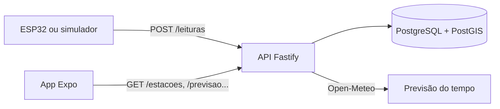

# AquaScan · Aplicativo

> API, banco de dados e app mobile do AquaScan: o nível dos rios de Petrópolis no celular, com alertas quando o risco aumenta.

Este repositório contém o software do projeto. O firmware das estações está no [repositório do ESP32](https://github.com/Tidxlz/Monitoramento-Fluxo-de--gua-ESP32), e o Business Model Canvas do projeto para a Supernova SEBRAE fica no repositório [aquascan-BMC](https://github.com/Mateus-Fonseca847/aquascan-BMC).

> **Status:** v0.1.0 em desenvolvimento. A API recebe leituras, calcula o estado dos rios e registra alertas; o app mostra mapa, detalhe das estações, previsão e pontos de apoio. Cadastro, pesquisa por rua e notificações push ainda não foram implementados ([roadmap](#roadmap)).

---

## Como funciona



A estação envia a distância medida até a água. A API converte em nível, calcula o percentual e o estado (estável, atenção, crítico) e registra um alerta quando o estado piora. As regras ficam em `packages/shared`, usadas igualmente pela API e pelo app.

## Stack

| Camada       | Tecnologia                                      |
| ------------ | ----------------------------------------------- |
| Linguagem    | TypeScript 6                                    |
| App          | React Native 0.86 com Expo SDK 57 e Expo Router |
| Mapa         | react-native-maps                               |
| Dados no app | TanStack Query                                  |
| API          | Node.js 22+ com Fastify 5 e Zod 4               |
| Banco        | PostgreSQL 17 + PostGIS, acessado pelo Prisma 7 |
| Monorepo     | pnpm workspaces                                 |
| Testes e CI  | Vitest e GitHub Actions                         |

Justificativas: [docs/decisoes.md](docs/decisoes.md).

## Estrutura

```
aquascan-app/
├── apps/
│   ├── api/              ← API (Fastify + Prisma)
│   └── mobile/           ← App (Expo)
├── packages/
│   ├── roteamento/       ← rotas a pé offline (A*), para o celular e o Node
│   └── shared/           ← regras de nível e estado, validações e tipos
├── tools/
│   ├── grafo/            ← constrói o grafo de ruas a pé (OpenStreetMap)
│   └── simulador/        ← imita uma estação enviando leituras
├── docs/                 ← requisitos, arquitetura, banco, API, decisões
├── docker-compose.yml    ← PostgreSQL + PostGIS para desenvolvimento
└── .github/workflows/    ← CI: formatação, tipos e testes
```

Cada pasta em `apps/`, `packages/` e `tools/` tem seu próprio README.

---

## Primeiro uso

### Pré-requisitos

| Ferramenta                 | Para quê             | Instalação                                                    |
| -------------------------- | -------------------- | ------------------------------------------------------------- |
| Node.js 22 ou mais recente | Rodar tudo           | [nodejs.org](https://nodejs.org)                              |
| pnpm                       | Gerenciar o monorepo | `corepack enable` (já vem com o Node)                         |
| Docker Desktop             | Banco de dados local | [docker.com](https://www.docker.com/products/docker-desktop/) |
| Expo Go (no celular)       | Abrir o app          | Play Store ou App Store                                       |

### Passo a passo

```bash
# 1. Instalar dependências (também gera o Prisma Client)
pnpm install

# 2. Criar os arquivos de ambiente
cp apps/api/.env.example apps/api/.env
cp apps/mobile/.env.example apps/mobile/.env      # coloque o IP do seu computador
cp tools/simulador/.env.example tools/simulador/.env

# 3. Subir o banco e criar as tabelas
pnpm db:up
pnpm db:migrate        # na primeira vez, dê o nome "init" à migração
pnpm db:seed           # dados fictícios: 2 estações, histórico e pontos de apoio

# 4. Em terminais separados:
pnpm dev:api           # API em http://localhost:3333
pnpm simulador         # simula o rio subindo
pnpm dev:mobile        # leia o QR code com o Expo Go
```

Teste rápido da API: abra `http://localhost:3333/estacoes` no navegador.

Algo deu errado? Veja [docs/solucao-de-problemas.md](docs/solucao-de-problemas.md).

## Comandos

Todos rodam na raiz do repositório.

| Comando                       | O que faz                                   |
| ----------------------------- | ------------------------------------------- |
| `pnpm dev:api`                | API com recarga automática                  |
| `pnpm dev:mobile`             | Servidor do Expo                            |
| `pnpm simulador`              | Envia leituras simuladas para a API         |
| `pnpm grafo:construir`        | Baixa o OSM e constrói o grafo de ruas a pé |
| `pnpm grafo:rios`             | Baixa o OSM e extrai os rios (GeoJSON)      |
| `pnpm grafo:exposicao`        | Mede a exposição das ruas aos rios          |
| `pnpm db:up` / `pnpm db:down` | Liga e desliga o banco no Docker            |
| `pnpm db:migrate`             | Aplica mudanças do `schema.prisma` no banco |
| `pnpm db:seed`                | Recria os dados de desenvolvimento          |
| `pnpm db:studio`              | Visualiza o banco no navegador              |
| `pnpm typecheck`              | Verifica os tipos de todos os pacotes       |
| `pnpm test`                   | Roda todos os testes                        |
| `pnpm format`                 | Formata o código com o Prettier             |

---

## Roadmap

| Versão     | Entrega                                                                                     | Requisitos                        |
| ---------- | ------------------------------------------------------------------------------------------- | --------------------------------- |
| **v0.1.0** | Estrutura, leituras, estado, alertas registrados, mapa, detalhe, previsão e pontos de apoio | RF03, RF05–RF07, RF09, RF10, RF12 |
| v0.2.0     | Cadastro e login com consentimento (LGPD)                                                   | RF01, RF02                        |
| v0.3.0     | Pesquisa por rua, pontos de apoio por proximidade, mapa estilizado                          | RF04, RF11                        |
| v0.4.0     | Notificações push (exige _development build_, o Expo Go não basta)                          | RF08                              |
| v0.5.0     | Estação real (firmware v0.6.0) e API publicada na internet                                  | —                                 |
| v1.0.0     | Versão apresentada na Supernova                                                             | —                                 |

Lista completa: [docs/requisitos.md](docs/requisitos.md). Histórico: [CHANGELOG.md](CHANGELOG.md).

## Documentação

| Documento                                               | Conteúdo                                           |
| ------------------------------------------------------- | -------------------------------------------------- |
| [requisitos.md](docs/requisitos.md)                     | O mapa mental traduzido em requisitos, com status  |
| [arquitetura.md](docs/arquitetura.md)                   | Como as partes se conectam e as regras de cálculo  |
| [banco-de-dados.md](docs/banco-de-dados.md)             | Tabelas, relações e migrações                      |
| [api.md](docs/api.md)                                   | Endpoints, exemplos e formato da leitura do ESP32  |
| [privacidade.md](docs/privacidade.md)                   | Dados pessoais coletados e cuidados de LGPD        |
| [creditos-dados.md](docs/creditos-dados.md)             | Atribuição e licenças dos dados de terceiros (OSM) |
| [validacao.md](docs/validacao.md)                       | Testes realizados e resultados                     |
| [solucao-de-problemas.md](docs/solucao-de-problemas.md) | Erros comuns e como resolver                       |
