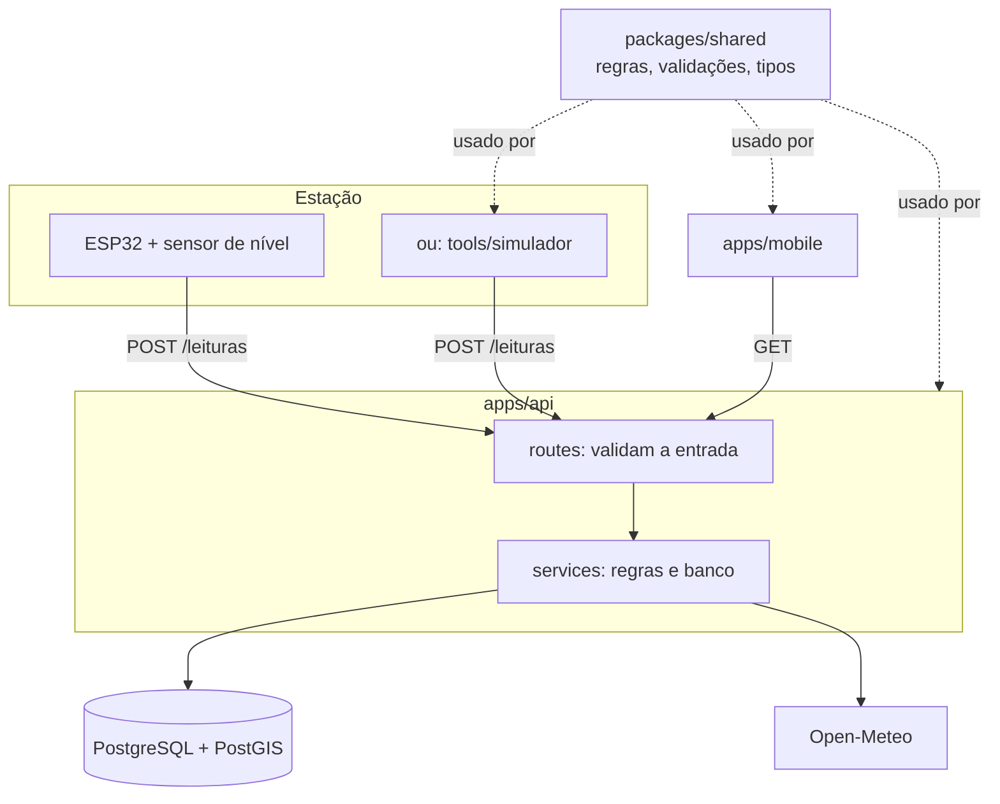

# Arquitetura

## Visão geral



## Por que um pacote compartilhado

O cálculo de nível e estado aparece em três lugares: a API calcula e salva, o app exibe e o simulador mostra o que espera. Se cada um tivesse sua cópia, uma mudança nos limites poderia deixar o app dizendo "Atenção" enquanto a API diz "Crítico". Com `packages/shared`, existe uma única fonte da verdade, coberta por testes.

O mesmo vale para os esquemas de validação: o app valida o cadastro com o mesmo esquema que a API usa.

## Fluxo de uma leitura

1. O ESP32 envia `POST /leituras` com `Authorization: Bearer <token>` e `{ "distanciaCm": 180.5 }`.
2. `autenticarEstacao` calcula o SHA-256 do token e encontra a estação.
3. O esquema `leituraEntradaSchema` valida o corpo; se inválido, a API responde 400.
4. `avaliarLeitura` calcula nível em cm, nível em % e estado com os parâmetros da estação.
5. A leitura é salva. Se o estado piorou em relação à leitura anterior, um alerta é registrado.
6. Em segundo plano (sem atrasar a resposta ao ESP32), a API envia a notificação push, pelo Expo Push Service, aos usuários **da mesma cidade da estação**. O alerta só é marcado como enviado quando o Expo aceita todos os lotes; se falhar, a rodada seguinte (a cada 30 s) tenta de novo. Antes de enviar, o cooldown por estação (30 minutos por padrão) suprime o alerta que não seja mais grave que o último push da estação; o alerta continua registrado e visível no app, só a notificação não sai. Para cada mensagem aceita, o Expo devolve um _ticket_, que a API guarda; 15 minutos depois (conferência a cada 5 minutos) ela consulta o recibo de entrega e apaga os tokens de aparelhos que não existem mais.
7. O app, que consulta a API a cada minuto, mostra o novo estado.

## Regras de cálculo

```
nível (cm)   = altura de instalação − distância medida
nível (%)    = nível ÷ nível de transbordamento × 100     (pode passar de 100%)
estado       = CRITICO se % ≥ limite crítico
               ATENCAO se % ≥ limite de atenção
               ESTAVEL caso contrário
estimativa   = (transbordamento − nível atual) ÷ velocidade de subida nos últimos 30 min
vazão (L/s)  = vazão (L/min) ÷ 60
```

Limites padrão: atenção a partir de 50%, crítico a partir de 80%. Cada estação pode ter os seus.

## Organização da API

Cada assunto é um módulo em `apps/api/src/modules/`. As rotas só validam a entrada e chamam o service; o service contém as regras e fala com o banco. Erros previstos usam `ErroHttp` (`lib/erros.ts`), e erros de validação do Zod viram respostas 400 automaticamente em `app.ts`.

## Organização do app

As telas ficam em `apps/mobile/app/` (cada arquivo é uma rota do Expo Router). As telas não chamam `fetch` diretamente: usam os hooks de `src/hooks/consultas.ts`, que usam `src/services/api.ts`. Assim, mudar a URL ou o formato de uma chamada exige alterar um único lugar.

## Roteamento no celular

O caminho a pé até um ponto de apoio é calculado **no próprio aparelho**, sem internet, e desvia de rios em estado crítico. Duas peças:

1. **O grafo de ruas** é gerado fora do app por [`tools/grafo`](../tools/grafo/README.md), a partir do OpenStreetMap: nós nas interseções, arestas com comprimento, geometria, nome, classe e marcas de escada, ponte e túnel (hoje um JSON de 1,9 MB para Petrópolis).
2. **O pacote [`packages/roteamento`](../packages/roteamento/README.md)** carrega esse grafo e calcula a rota com **A\***. Ele encaixa a origem e o destino no ponto mais próximo de **qualquer aresta** (não só nos nós) e aceita um **multiplicador de custo por aresta** (`>= 1`; `Infinity` bloqueia). Os multiplicadores são a forma de o estado dos rios entrar na conta: o roteador devolve, em cada trecho, o multiplicador usado, e **quem chama** decide a política de segurança.

**O desvio de rios** fica no pacote [`packages/desvio`](../packages/desvio/README.md), que junta três fontes: o roteador, a **exposição** das ruas aos rios (estática: `tools/grafo` calcula, uma vez, se cada rua cruza o rio e que fração dela fica a até 15, 30 e 50 m, em um arquivo amarrado ao grafo pelo hash) e o **estado das estações** (dinâmico, muda a cada minuto). O fluxo, a cada consulta:

1. **Estado das estações**: a última leitura de cada estação (como a API devolve) e a hora de agora.
2. **Estado efetivo**: leitura fresca (até 20 min) vale como está; CRITICO ou ATENCAO antigo continua valendo por até 6 h (**falha segura**); o resto vira `DESCONHECIDO`, sem penalidade.
3. **Estado de cada trecho de rio**: os rios são fatiados em trechos de até 250 m (`tools/grafo`); cada trecho tem o estado da estação mais próxima do mesmo rio, até 1000 m, e fora disso é "sem monitoramento". É a **mesma função que colore o mapa**.
4. **Multiplicador por rua**: as frações dos trechos que a rua toca são **somadas** por estado (cada amostra da rua pertence a um só trecho): `1 + 49 × FC + 3 × FA`, com `FC` e `FA` limitadas a 1 no total (crítico: faixa de 50 m; atenção: faixa de 15 m) e uma fração mínima para quem cruza o rio.
5. **Duas passadas**: a estrita bloqueia (`Infinity`) as ruas que cruzam rio crítico; se não houver rota, a de reserva as permite com penalidade, e o resultado vem como `menos_exposta` com aviso.

O resultado traz a rota recomendada, a mais curta quando ela for bem mais exposta, os avisos e os estados usados. Os rios sem estação não são evitados: o app deve avisar que o desvio vale apenas para os rios monitorados. Os números da política são provisórios (veja [decisoes.md](decisoes.md)).

**Instruções e acompanhamento.** Com a rota calculada, o mesmo pacote gera as **instruções de curva** (`gerarPassos`: "Vire à direita na Avenida Koeler", com distância, avisos de escada, trilha, ponte e túnel, e o ponto de cada manobra) e acompanha a pessoa no caminho (`acompanhar`: dada a posição do GPS, diz o passo atual, quanto falta e se ela saiu da rota). As duas são funções puras; quando a pessoa sai da rota, a tela chama o `rotear` de novo. Rotatórias não são reconhecidas e o texto das preposições é heurístico.

O pacote roda no Hermes (o motor do app) e no Node, então `src/` não usa nenhuma API do Node; um teste garante isso. A API do AcquaScan **não participa** do cálculo de rotas. A justificativa está em [decisoes.md](decisoes.md).

## Ambientes

| Ambiente        | API                                          | Banco                                          |
| --------------- | -------------------------------------------- | ---------------------------------------------- |
| Desenvolvimento | `pnpm dev:api` no computador                 | Docker Compose                                 |
| Produção        | [PREENCHER na v0.5.0: serviço de hospedagem] | [PREENCHER: PostgreSQL gerenciado com PostGIS] |
