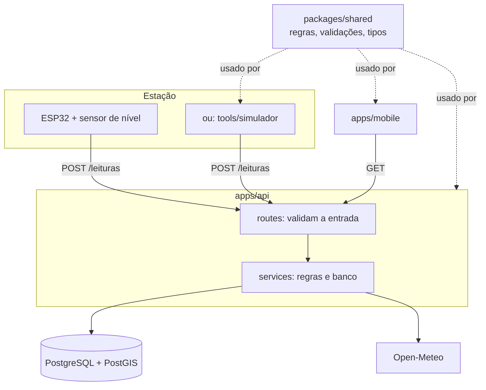

# Arquitetura

## Visão geral



## Por que um pacote compartilhado

O cálculo de nível e estado aparece em três lugares: a API calcula e salva, o app exibe e o simulador mostra o que espera. Se cada um tivesse sua cópia, uma mudança nos limites poderia deixar o app dizendo "Atenção" enquanto a API diz "Crítico". Com `packages/shared`, existe uma única fonte da verdade, coberta por testes.

O mesmo vale para os esquemas de validação: o app valida o cadastro com o mesmo esquema que a API usa.

## Fluxo de uma leitura

1. O ESP32 envia `POST /leituras` com `Authorization: Bearer <token>` e `{ "distanciaCm": 180.5 }`.
2. `autenticarEstacao` calcula o SHA-256 do token e encontra a estação.
3. O esquema `leituraEntradaSchema` valida o corpo; se inválido, a API responde 400.
4. `avaliarLeitura` calcula nível em cm, nível em % e estado com os parâmetros da estação.
5. A leitura é salva. Se o estado piorou em relação à leitura anterior, um alerta é registrado.
6. O app, que consulta a API a cada minuto, mostra o novo estado.

## Regras de cálculo

```
nível (cm)   = altura de instalação − distância medida
nível (%)    = nível ÷ nível de transbordamento × 100     (pode passar de 100%)
estado       = CRITICO se % ≥ limite crítico
               ATENCAO se % ≥ limite de atenção
               ESTAVEL caso contrário
estimativa   = (transbordamento − nível atual) ÷ velocidade de subida nos últimos 30 min
vazão (L/s)  = vazão (L/min) ÷ 60
```

Limites padrão: atenção a partir de 50%, crítico a partir de 80%. Cada estação pode ter os seus.

## Organização da API

Cada assunto é um módulo em `apps/api/src/modules/`. As rotas só validam a entrada e chamam o service; o service contém as regras e fala com o banco. Erros previstos usam `ErroHttp` (`lib/erros.ts`), e erros de validação do Zod viram respostas 400 automaticamente em `app.ts`.

## Organização do app

As telas ficam em `apps/mobile/app/` (cada arquivo é uma rota do Expo Router). As telas não chamam `fetch` diretamente: usam os hooks de `src/hooks/consultas.ts`, que usam `src/services/api.ts`. Assim, mudar a URL ou o formato de uma chamada exige alterar um único lugar.

## Ambientes

| Ambiente        | API                                          | Banco                                          |
| --------------- | -------------------------------------------- | ---------------------------------------------- |
| Desenvolvimento | `pnpm dev:api` no computador                 | Docker Compose                                 |
| Produção        | [PREENCHER na v0.5.0: serviço de hospedagem] | [PREENCHER: PostgreSQL gerenciado com PostGIS] |
