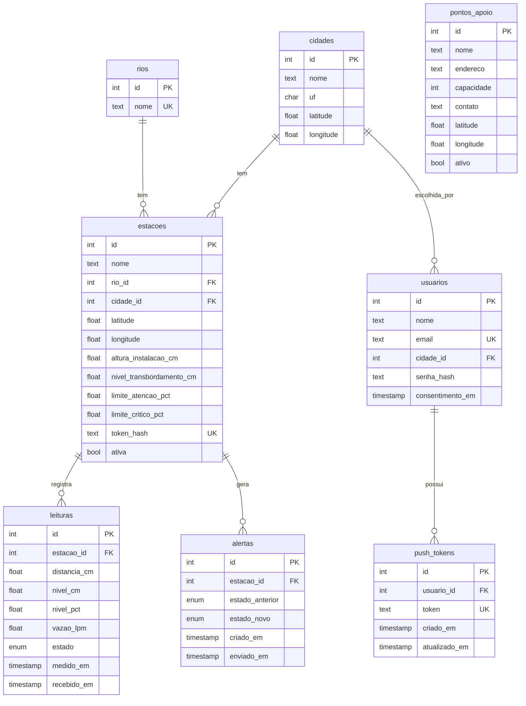

# Banco de dados

PostgreSQL com a extensão PostGIS. O modelo é definido em [`apps/api/prisma/schema.prisma`](../apps/api/prisma/schema.prisma).

## Diagrama



## Convenções

- No código (Prisma), campos em `camelCase`. No banco, tabelas e colunas em `snake_case` (via `@map`).
- Consultas SQL diretas (`$queryRaw`) usam os nomes do banco, como `pontos_apoio` e `distancia_m`.
- A leitura guarda a **distância bruta** e também o nível e o estado calculados. Se os parâmetros da estação mudarem, o histórico continua mostrando o estado da época.

## Cidades

A tabela `cidades` guarda nome, UF (2 letras) e o centro da cidade (latitude e longitude). A combinação `nome` + `uf` é única.

- Toda **estação** pertence a uma cidade (`estacoes.cidade_id`, obrigatório).
- Todo **usuário** escolhe uma cidade no cadastro (`usuarios.cidade_id`, obrigatório). O banco não guarda CEP nem coordenadas do usuário: a região dos alertas é a cidade, e o centro dela (`cidades.latitude/longitude`) serve de referência.
- Apagar uma cidade é recusado enquanto houver estações ou usuários nela.
- A migração `cadastro_por_cidade` tornou `usuarios.cidade_id` obrigatório (usuários antigos foram para Petrópolis) e apagou as colunas `cep`, `latitude` e `longitude` de `usuarios`, com os dados delas.
- A migração `adiciona_cidades` criou Petrópolis/RJ e ligou a ela as estações que já existiam. Para criar a coluna obrigatória em uma tabela com dados, o SQL gerado pelo Prisma foi editado: a coluna entra opcional, é preenchida e só então vira `NOT NULL`.

## Tokens de push

`push_tokens` guarda um token do Expo por aparelho (`token` é único). `atualizado_em` é a última vez que o app registrou o token; serve para apagar os mais antigos quando um usuário passa de 10. Se o mesmo token for registrado por outro usuário, a linha é reatribuída (`usuario_id` muda) em vez de duplicada. Os tokens saem junto com o usuário (`ON DELETE CASCADE`).

## Coordenadas e PostGIS

Para o MVP, as coordenadas ficam em colunas `latitude` e `longitude` comuns, e as consultas por distância montam o ponto geográfico na hora:

```sql
ST_Distance(
  ST_SetSRID(ST_MakePoint(longitude, latitude), 4326)::geography,
  ST_SetSRID(ST_MakePoint(-43.178, -22.505), 4326)::geography
)  -- distância em metros
```

Com dezenas de pontos isso é instantâneo. Quando a pesquisa por rua chegar (v0.3.0), as ruas do OpenStreetMap precisarão de colunas geográficas de verdade, com índice espacial.

## Migrações

```bash
# 1. Edite apps/api/prisma/schema.prisma
# 2. Gere e aplique a migração (dê um nome descritivo)
pnpm db:migrate
# 3. Commite a pasta apps/api/prisma/migrations junto com o schema
```

Regras:

- Nunca edite uma migração que já foi para a `main`. Crie uma nova.
- A primeira migração (`init`) é criada no primeiro `pnpm db:migrate` e deve ser commitada.
- Em produção, use `pnpm --filter @acquascan/api db:deploy`, que só aplica migrações existentes.

## Dados de desenvolvimento

`pnpm db:seed` **apaga** estações, leituras, alertas e pontos de apoio e recria dados fictícios. As cidades não são apagadas: o seed as cria ou atualiza (`upsert`), porque os usuários as referenciam e o seed nunca apaga usuários. Nunca rode em produção.
